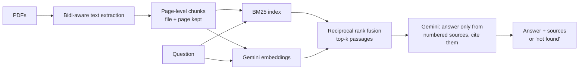

# Ask Your Documents: Arabic + English RAG Chatbot

Upload PDFs, ask questions in Arabic (including Egyptian dialect) or English, and get answers that come **only** from your documents. Every fact links to its **file and page**. If the answer isn't in the documents, the bot says so instead of guessing.

Built with Python, Google Gemini, hybrid search (BM25 + embeddings) and Streamlit.

## Features

- **Cited answers.** Each sentence cites a numbered source, and the UI shows the file, page and passage behind it.
- **No made-up answers.** The model must reply `NOT_FOUND` when the sources don't hold the answer. Answers that cite nothing get a visible warning.
- **Arabic that extracts correctly.** Arabic PDFs exported from Microsoft Word break plain text extraction: numbers inside Arabic text come out reversed (`21` becomes `12`) and the lam-alef ligature comes out wrong (`الإجازة` becomes `اإلجازة`). This project rebuilds each Arabic line from glyph positions, so numbers, ligatures and word spacing come out right. It is tested on Word output and on Arabic pages from a real Egyptian tender document. Pages with no Arabic keep PyMuPDF's own output, unchanged.
- **Hybrid search.** BM25 catches exact terms, numbers and names. Gemini embeddings catch paraphrases, dialect and cross-language questions. The two rankings are merged with reciprocal rank fusion.
- **Arabic-aware keyword search.** Normalizes letter variants (أ/إ/آ → ا, ة → ه, ى → ي), diacritics, Arabic-Indic digits and the definite article.
- **Works without a key.** With no API key the app runs keyword search and shows the best passages.

## How it works



Chunks never cross a page boundary, so every citation points to exactly one page.

## Evaluation

`eval/questions.jsonl` has 28 questions on the two sample documents:
- 12 Arabic questions, written in Egyptian dialect
- 10 English questions
- 2 cross-language questions
- 4 questions the documents can't answer

| Metric | Keyword only (BM25) | Hybrid + Gemini answers |
|---|---|---|
| Right page ranked first (hit@1) | 21/24 (88%) | 24/24 (100%) |
| Answer contains the expected facts | n/a | 24/24 (100%) |
| Answer cites the right page | n/a | 24/24 (100%) |
| Refuses unanswerable questions | n/a | 4/4 (100%) |

Run on 2026-10-24 with `gemini-3.5-flash-lite` and `gemini-embedding-001` (768 dimensions). Every answer was also read by hand.

What the numbers show:
- **Hybrid search fixes the cases BM25 misses.** BM25 alone fails on three questions: the dialect question `لو عايز أستقيل` (the policy says `الاستقالة`) and both cross-language questions. With embeddings added, all three rank the right page first.
- **The model stays on the sources.** It answers in the question's language, cites the right page, and refuses all four questions the documents don't cover.

What they don't show:
- **The corpus is tiny.** It has 6 pages, and top-k is 6, so the model sees every page on every question. That makes answering and refusing easier than on a real document set.
- **I wrote the questions.** They were written alongside the sample documents, so they aren't a held-out benchmark.
- **The answers aren't perfectly polished.** The lite model sometimes leaves small typos in Arabic, for example a doubled letter at the start of one answer.

Run it yourself:

```bash
python eval/run_eval.py --retrieval-only --keyword-only   # offline, no key
python eval/run_eval.py                                   # full run with Gemini
```

## Run locally

```bash
python -m venv .venv
.venv\Scripts\activate          # Windows (macOS/Linux: source .venv/bin/activate)
pip install -r requirements.txt
copy .env.example .env          # then put your key in GEMINI_API_KEY
streamlit run app.py
```

Get a free Gemini API key at [aistudio.google.com/apikey](https://aistudio.google.com/apikey). Model names and chunk settings can be changed in `.env` (see `.env.example`). The default chat model is `gemini-3.5-flash-lite`: on the free tier during testing it answered in 1-3 seconds, while `gemini-3.8-flash` took over a minute per request.

Tests:

```bash
pip install pytest
pytest
```

## Project layout

```
app.py                  Streamlit UI
src/ragchat/
  pdftext.py            bidi-aware PDF text extraction (Arabic fixes)
  documents.py          PDF loading and page-level chunking
  text.py               Arabic/English normalization and tokenization
  index.py              hybrid BM25 + embedding index, save/load
  answer.py             prompt, citation parsing, not-found handling
  llm.py                Gemini embeddings and generation, with retry
eval/                   questions and evaluation script
samples/                two sample PDFs (fictional company)
scripts/make_samples.py regenerates the samples with Microsoft Word
tests/                  unit tests (no API key needed)
```

## Limitations

- Scanned PDFs with no text layer are skipped. OCR isn't included yet.
- A line that mixes a Latin word into Arabic text can put the punctuation next to the Latin word on the wrong side (for example `".category`). The words themselves are kept.
- Each question is answered on its own. Follow-ups like "and the second one?" aren't rewritten using chat history.
- The index is kept in memory per session, which is right for a demo but not for thousands of documents. A vector database would replace it at that scale.

## License

AGPL-3.0, because the project uses [PyMuPDF](https://pymupdf.readthedocs.io/). The sample documents describe a fictional company and were written for this project.
